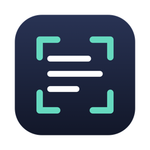
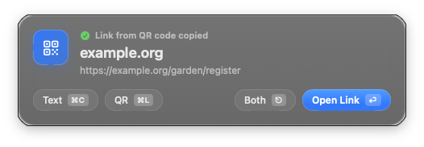
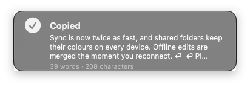
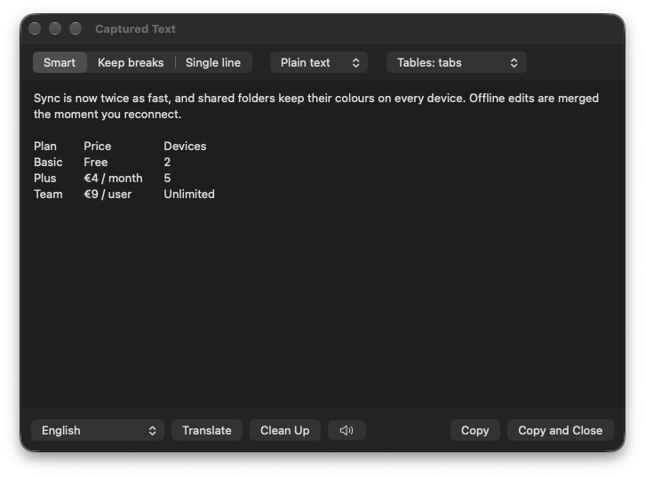
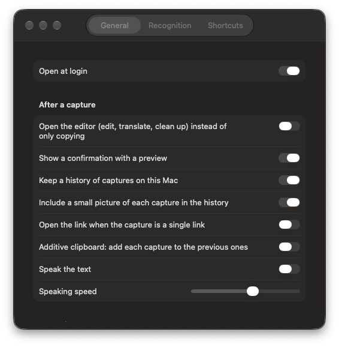

<p align="center">
  
</p>

<h1 align="center">TextGrabber</h1>

<p align="center">
  <b>Copy text from anything on your screen.</b><br>
  Select an area and the text is on your clipboard: paragraphs, tables, emoji, QR links and all.<br>
  A small macOS menu bar app that does everything on your Mac.
</p>

<p align="center">
  
  
  
  
</p>

<p align="center">
  
</p>

## Features

**Capture**
- **One shortcut, anywhere.** Press ⇧⌘1, drag over anything on screen, and the text is copied. Shortcuts are yours to change.
- **Capture the last area again**, keep every line break, or read the image on the clipboard.
- **Options while you select**: press **C** to add the text to what is already on the clipboard, **L** to keep its line breaks, **S** to hear it read aloud. For that capture only; a small strip shows which are on.
- **Scrolling capture** for text longer than the screen: scroll, and the pictures are joined without repeats.
- **Images and PDFs**: drop them on the app icon, or open them from the menu.
- **Every display**, Retina or not, including screens above or left of the main one.

**Text that comes out right**
- **Layout that reads like a person**: paragraphs joined, lists and headings kept, a sidebar read before the content beside it, hyphenated words repaired.
- **Tables stay tables**, even with wrapped cells, and copy as tabs (paste into a spreadsheet), CSV or Markdown.
- **Small text** is enlarged before reading, and unsure lines and empty table cells are read again on their own.
- **Exact emoji and symbols** (👍 ✅ ⌘ ⇧): when you capture an app window, TextGrabber uses the app's own text wherever it matches what it read.
- **Many languages**, detected automatically, with a main language and custom words you can set.

**QR codes and barcodes**
- **The same shortcut reads codes.** Aim at a code and you get its content; capture a page with a code and you get the text, then the link.
- **A glass confirmation** shows the site a link goes to before you open it: **Text** ⌘C, **QR** ⌘L, **Both** ⎋, **Open Link** ⏎.

**After a capture**
- **Editor**: change line breaks and format, **translate** on this Mac (macOS 15+), or **clean up** misreads with Apple Intelligence (macOS 26+).
- **History** of past captures with small pictures, pinning and search.
- **Optional extras**: read every capture aloud, add every capture to the text on the clipboard, open a captured link.

**Automation**
- **Shortcuts and Siri** actions: capture text, read a QR code, extract text from images and PDFs.
- **URL actions** (`textgrabber://capture`, …) for Raycast, Alfred and scripts, Raycast script commands, and a **command line** that reads files.

**Private and light**
- **Everything happens on your Mac**: recognition, translation and clean-up. Screenshots are read in memory and deleted at once.
- **Light**: about 20 MB of memory while idle, and nothing running between captures.

## Screenshots

<table>
  <tr>
    <td align="center"><br><sub>A QR code: check the site, then ⏎ to open</sub></td>
    <td align="center"><br><sub>Every capture is confirmed with a preview</sub></td>
  </tr>
  <tr>
    <td align="center"><br><sub>The editor: line breaks, Markdown, CSV, translate, clean up</sub></td>
    <td align="center"><br><sub>Settings</sub></td>
  </tr>
</table>

## Getting started

```sh
./scripts/setup-signing.sh   # once: a local signing identity, so macOS permissions survive rebuilds
./scripts/build-app.sh       # builds, installs to /Applications and starts it
```

On first launch a setup window walks through the two permissions: **Screen Recording** (required; macOS applies it after a restart, so the window offers a Restart button) and **Accessibility** (recommended, for exact emoji and symbols). It comes back whenever Screen Recording is missing, and from the menu with "Set Up TextGrabber…". Then press ⇧⌘1 anywhere. The menu bar icon has everything else.

The README media is regenerated with `scripts/readme-media/make.sh` (demo content only; nothing from your screen).

## Reading windows and small text

- On macOS 26 and later, Apple's document recognition decides what belongs together: paragraphs, list items and table cells, including cells whose text wraps over several lines. The words themselves still come from TextGrabber's own recognition, so enlargement, retries and exact text from apps all still apply. Where it is unavailable, TextGrabber's own layout rules take over.

- A sidebar beside its content, or any panes whose lines do not line up with each other, are read one after the other. Columns of a table or grid, whose rows do line up, stay together.
- Small text is enlarged before reading, based on the height of the letters. This matters most on non-Retina displays.
- A line recognition was unsure about is read a second time from an enlarged crop; this catches small text that would otherwise come back upside-down.

## QR codes and barcodes

The normal capture shortcut reads codes too; no separate shortcut is needed.

- **Capturing a code** (with a caption such as "Scan me", the link printed under it, or bits of text the selection cut through): the clipboard gets what the code contains.
- **Capturing a page that has a code** (a poster, an invoice, a sign-in card): the clipboard gets the text, a blank line, then the code's content, unless the text already contains it.

Text read inside a code, lines cut by the edge of the selection, text that repeats the code and fragments that are not words do not count; when fewer than 8 words are left, the capture is about the code. The confirmation shows what was copied, with the site a link goes to in large type, and lets you change it: **Text** (⌘C) for the text only, **QR** (⌘L) for the code only, or **Both** (⎋) for the text and then the link on its own line. **Open Link** (⏎) copies both as well and opens the link; nothing opens by itself unless "Open the link when the capture is a single link" is on. While the confirmation shows it takes the keyboard without bringing TextGrabber to the front, and any other key closes it and goes on to the app you were in (this needs Accessibility; without it the confirmation works by click only). A code alone, with no link and no text around it, has nothing to choose: it gets the same short notice as any capture. Settings → Recognition can turn code reading off; "Read QR Code or Barcode" in the menu still reads codes only.

## Options while you select

While the crosshair is showing, three keys change what happens to this capture:

| Key | Option |
|---|---|
| **C** | **Add to the clipboard**: the text goes after the text already on the clipboard instead of replacing it |
| **L** | **Keep line breaks**: every line stays a line, and added text starts on a new line |
| **S** | **Read aloud**: the captured text is spoken once it is copied (only this capture, not the whole clipboard) |

Each press switches that option on or off, starting from the settings (General, and the menu's Additive Clipboard, Line Breaks and Speak After Capture), so with Additive Clipboard always on, C makes one capture replace the clipboard instead. Press them before or during the drag. At the first press a strip at the bottom of the screen shows which options are on; it moves to the top when the pointer comes near, and it never appears in the capture.

Added text continues the same line, with a space, as if the two pieces were one paragraph: a word hyphenated across the two is put back together, and Chinese and Japanese text gets no space. It goes on a new line when line breaks are kept, and always next to a table, so rows are not run together. If the clipboard holds no text (an image, or nothing), the capture is copied as usual.

The keys are taken only while the crosshair shows, and typed letters again the moment it closes. Change them in Settings → Shortcuts. ⌘ and ⌃ cannot be part of them: while you select, macOS uses ⌘ to switch to Visual Intelligence (each press switches, and a selection made then is not a screenshot), and ⌃ held when you let go sends the screenshot to the clipboard.

## Scrolling capture

For text longer than the screen: choose "Scrolling Capture…" (menu, a shortcut you set, or `textgrabber://capture-scrolling`), select the area, then scroll through the content. A small panel above the area counts the pictures taken; press Done there, or the same shortcut again, at the end. Pictures are joined by matching the lines they share, so nothing is repeated; if you scroll so fast that two pictures share no line, the confirmation says text may be missing.

## The editor

"Capture and Edit…" (menu, or a shortcut you set) opens the result in an editor instead of only copying it; Settings can make that the default. "Edit Last Capture…" reopens the last one, and history entries have an Edit button. In the editor you can:

- edit the text, switch line breaks (smart, keep, single line) and format (plain text or Markdown; tables as tabs, CSV or Markdown);
- **translate** it with Apple's on-device translation (macOS 15+), keeping lines and table columns;
- **clean up** recognition mistakes with Apple's on-device model (macOS 26+, Apple Intelligence on). A reply that changes too many words is refused. Check the result: the model can guess wrong.

Nothing leaves the Mac for either.

## History

Captures are kept on this Mac (up to 200, searchable), each with a small picture of what was captured; the picture can be turned off in Settings. Pin a capture to keep it at the top: pinned captures are never dropped when the history is full, nor by "Clear History".

## Emoji and symbols

Apple's text recognition cannot read emoji or symbols such as ⌘ and ⇧. When the area you capture is a real app window, TextGrabber reads that window's own text through the Accessibility API and uses it for every line it can match, so those characters come out right. The confirmation says "exact text from the app" when this happened.

It needs a second permission: Settings → Recognition → Grant Access. Without it, captures still work with recognition alone. Images, videos and apps that expose no text also fall back to recognition alone.

Every screen capture writes a plain account of what happened to `~/Library/Logs/TextGrabber/last-capture.txt`: whether access is on, which app was under the capture, the text it exposed for each line, and which lines were taken from it. `open "textgrabber://probe?rect=x,y,w,h"` reads an area into that log without touching the clipboard. `scripts/drive.sh "probe?rect=x,y,w,h"` does the same and prints the log once it is written.

To see what an app exposes at a screen point: `TextGrabber --ax-at 400,300` (the terminal you run it from needs Accessibility access).

## Build

```sh
swift test                 # layout engine tests
./scripts/build-app.sh     # builds, installs to /Applications and starts it
./scripts/build-app.sh --fast   # this Mac's architecture only, for trying a change
```

Run `./scripts/setup-signing.sh` once before the first build. It creates a self-signed signing identity in its own keychain, so rebuilt apps keep their macOS permissions. Without it the app is signed ad hoc, and macOS asks for Screen Recording and Accessibility again after every rebuild (and keeps asking until the stale entry is cleared with `tccutil reset ScreenCapture app.textgrabber.TextGrabber`).

## Tests

- `LayoutEngineTests`: the layout rules on synthetic fragments.
- `CaptureCorpusTests`: real recognition on every image in `Tests/TextGrabberCoreTests/Fixtures/captures`, compared with the text file beside it. Add real screenshots there; see its README.
- `CodeTriageTests`: the code-or-text decision, and real recognition on every capture in `Fixtures/codes` (drawn by `scripts/make-code-fixtures.swift`).
- `ExactTextTests`: restoring emoji and symbols from an app's text, using misreads Apple's recognition really produced.

The first run in a fresh build can take about a minute while macOS prepares the recognition models; later runs take about a second.

Tests run before every commit. On a fresh clone, turn that on with `git config core.hooksPath scripts/hooks`.

## Automation

**Shortcuts** has three TextGrabber actions: *Capture Text from Screen* and *Read QR Code from Screen* (you select an area; the action returns the text), and *Extract Text from Image* (images or PDFs in, text out, with line-break and format options). "Capture text with TextGrabber" also works with Siri and Spotlight. The build script generates the metadata Shortcuts needs, which Xcode would normally produce.

**Raycast**: add `integrations/raycast` as a script directory (see its README).

URL actions, for Shortcuts ("Open URL"), Raycast, Alfred or scripts:

| URL | Does |
|---|---|
| `textgrabber://capture` | Capture text |
| `textgrabber://capture-edit` | Capture text and open the editor |
| `textgrabber://capture-scrolling` | Start a scrolling capture, or finish the one running |
| `textgrabber://capture-last-area` | Capture the last area again |
| `textgrabber://capture-keep-lines` | Capture text, keeping line breaks |
| `textgrabber://read-code` | Read only QR codes and barcodes (the normal capture reads them too) |
| `textgrabber://clipboard` | Read the image on the clipboard |
| `textgrabber://open?path=/abs/file.png` | Read files (repeat `path` for several) |
| `textgrabber://edit-last` | Reopen the last capture in the editor |
| `textgrabber://history`, `textgrabber://settings`, `textgrabber://setup` | Open those windows |
| `textgrabber://probe?rect=x,y,w,h` | Read that screen area into the capture log only |
| `textgrabber://snapshot?window=setup` | Draw a window (`setup`, `settings`, `history`, `editor`) to a PNG in `~/Library/Logs/TextGrabber`, without taking focus; works while the screen is locked. `tab=general\|recognition\|shortcuts` picks the settings tab |

Add `edit=1` to any capture action to open the editor for that capture, and `add=1`, `keep-lines=1` or `speak=1` (or `=0`) to start it with that option on (or off), as the C, L and S keys would.

`textgrabber://selftest-capture-options?keys=additive,keepLines,speak` checks the option keys on this Mac: it shows a test window, makes a real capture of it while pressing the keys, and writes the result to the capture log. The clipboard is pretend (`base=` sets its text), nothing is spoken and nothing goes to the history. `variant=middrag` presses the keys during the drag; `variant=command` presses ⌘ first, to see whether macOS still takes ⌘ while you select. It needs Accessibility, moves the pointer for about three seconds, and puts it back.

## Command line

The same binary reads files when given arguments:

```sh
/Applications/TextGrabber.app/Contents/MacOS/TextGrabber --mode paragraphs scan.png
/Applications/TextGrabber.app/Contents/MacOS/TextGrabber --barcode ticket.png
/Applications/TextGrabber.app/Contents/MacOS/TextGrabber --markdown --translate id table.png
/Applications/TextGrabber.app/Contents/MacOS/TextGrabber --help
```

## Layout

| Path | What it is |
|---|---|
| `Sources/TextGrabberCore/LayoutEngine.swift` | Turns OCR fragments into text: reading order, columns, tables, paragraphs, hyphenation |
| `Sources/TextGrabberCore/Recognizer.swift` | Vision text and barcode recognition, image upscaling, PDF pages |
| `Sources/TextGrabberCore/CodeTriage.swift` | Whether a capture with a code is about the code or about the text around it |
| `Sources/TextGrabberCore/DocumentLayout.swift` | Lays recognised lines out with Apple's paragraph and table structure |
| `Sources/TextGrabberCore/StructuredText.swift` | Text as blocks and tables; writes plain text, Markdown, CSV |
| `Sources/TextGrabberCore/ExactText.swift` | Matches recognised lines against an app's real text to restore emoji and symbols |
| `Sources/TextGrabber/` | The menu bar app: capture, shortcuts, clipboard, HUD, history, settings, CLI |
| `Tests/TextGrabberCoreTests/` | Layout engine tests |

## License

MIT. See [LICENSE](LICENSE).
